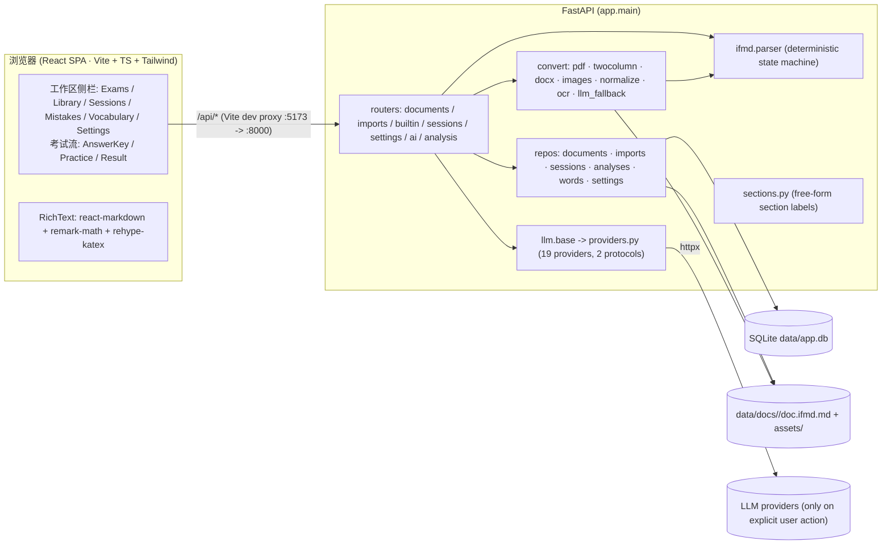
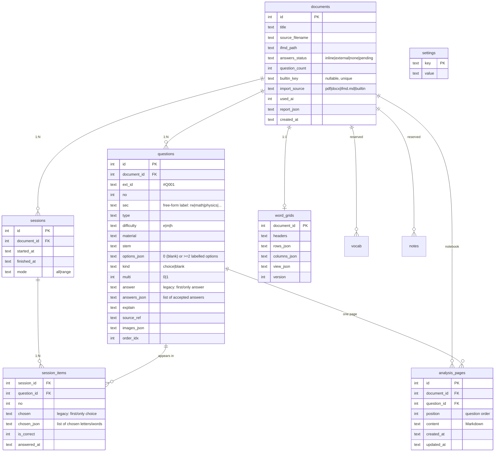

# InteFlow — Architecture

> 本地优先（local-first）的学习工作流应用。单机运行：FastAPI 后端 + React 前端 + SQLite 单文件；
> PDF 由 PyMuPDF 确定性转换；LLM 仅在用户显式点击时调用（导入主链路 0 token）。
>
> 基线：pytest **218 passed, 1 skipped**、`npm run build` 0 错误、`npm test` 88 passed, 5 skipped。
> 相关：[`README.md`](../README.md)、[`AGENT.md`](../AGENT.md)、[`IFMD.md`](IFMD.md)、[`IDEAS.md`](IDEAS.md)、[`ROADMAP.md`](../ROADMAP.md)。

---

## 1. 系统总览



### 关键不变量（Iron rules）
- **LLM 不在导入主链路**：导入是纯确定性转换，0 token；AI 仅在用户显式点击时调用。
- **正确答案不出后端**：练习接口 `quiz_questions()` 剥掉 `answer` 字段；只有提交/复盘接口返回。
- **本地优先**：全部数据在 `data/`（SQLite 单文件 + 文档/图片），无云依赖。
- **单文件数据库 + 文件系统并存**：SQLite 存索引与结构化题，`doc.ifmd.md` 存原始 InteFlow-MD（source of truth），`assets/` 存图片。
- **不局限于 SAT**：题目的 `sec` 是自由标签（见 §3、`app/sections.py`）。
- **一套试卷 = 一套复盘笔记本**：分析正文存 `analysis_pages`（一题一页，按题序）；复盘页顶部 **Notebook** 全屏预览（标题 + 所有已写解析的题干/图表/解析），导出 PDF/DOCX/MD 只含已写解析的题，并在 `data/exports/` 留一份副本（响应头 `X-Export-Path`）。

---

## 2. 运行形态与数据目录

```
repo/
├── backend/                 FastAPI 应用
│   ├── app/                 源码（见 §5）
│   ├── tests/               pytest（218）
│   └── requirements.txt     fastapi uvicorn pymupdf python-multipart httpx pytest openpyxl weasyprint python-docx cairosvg
├── frontend/                Vite + React 19 + TS + Tailwind 4
│   └── src/                 页面/组件/api client（见 §4）
├── scripts/dev.sh           一键起后端(:8000)+前端(:5173)
├── data/                    运行期数据（gitignore）
│   ├── app.db               SQLite
│   ├── docs/<id>/           doc.ifmd.md + assets/
│   ├── tmp/                 上传暂存（用完即删）
│   ├── jobs/                导入流水线暂存
│   └── exports/             导出产物目录
└── docs/                    ARCHITECTURE / IFMD / IDEAS / legacy
```

环境变量：`INTEFLOW_DATA`（数据根，默认 `./data`）、`INTEFLOW_API`（Vite 代理目标，默认 `http://localhost:8000`）、
`INTEFLOW_OCR_LANG`（Tesseract 语言，默认 `eng`）、`INTEFLOW_DEFAULT_SECTION`（无板块标题时的回退标签，默认 `rw`）。

---

## 3. 数据模型（ER）



保留但**未使用**的表（历史占位）：`analyses`、`vocab`、`notes`、`llm_logs`。分析正文现用 `analysis_pages`（旧 `questions.explain` 首次读取时映射迁移，不落库）。

---

## 4. 前端结构

```
App.tsx (BrowserRouter)
└── AppShell  —— 非考试页包在纸墨工作区（左侧栏 + 移动抽屉）；复盘与练习全屏无壳
    ├── "/"                     ExamHomePage      —— Exams：选卷开考（统计 + 编号行）
    ├── "/library"              ImportPage        —— Library：导入流水线 + 模板 + 内置题库卡 + 试卷列表
    ├── "/sessions"             SessionsPage      —— Sessions：所有作答历史（按时间倒序、搜索、删除）
    ├── "/mistakes"             MistakesPage      —— 错题分析集合（占位）
    ├── "/vocabulary"           VocabularyPage    —— 单词整理集合（占位）
    ├── "/settings"             SettingsPage      —— LLM 服务商配置 + 用户名 + AI 兜底开关
    ├── "/doc/:id/answers"      AnswerKeyPage     —— 答案网格（多选 + 填空多答案）+ 批量粘贴 + 预览（含侧栏）
    ├── "/doc/:id/practice"     PracticePage      —— 全屏练习（计时，无侧栏、保持 slate/blue）
    ├── "/session/:sid/result"  ResultPage        —— 载入会话 → 全屏复盘工作台（无侧栏）
    └── "/manage"               → 重定向到 /library（兼容旧链接）

components/  AppSidebar（六个 tab：Exams/Library/Sessions/Mistakes/Vocabulary/Settings）· RichText (markdown+KaTeX+图片) ·
             workspace/（Workspace 左右分屏+工具栏 · QuestionNav 左上角折叠悬浮题目导航 (All/Wrong/Correct) ·
             AnalysisEditor Pages 式分析页 (Write/Preview + 自动保存 + 单换行保留) · NotebookPreview 整套解析预览/导出 ·
             StudyDrawer AI/单词表/导出抽屉 ·
             VocabularySheet 底部词汇表 · VocabGrid v2 电子表格 · Splitter 分隔条 · usePersistentLayout · useMediaQuery · icons）·
             ImportPipeline · IfmdTemplate · LibraryList · BuiltinBankCard · ui/（设计系统原语）
lib/         sections.ts（板块标签，与后端 sections.py 对齐）
api/client.ts —— 类型化 API client（所有 /api 路径由 Vite 代理）
```

复盘布局持久化在 `localStorage` 键 `inteflow.workspace.v2.<docId>`（左右栏宽、抽屉 Tab）；
可拖拽分隔条为 `role="separator"` 且支持方向键。

**主题层**：`.app-theme[data-theme=…]`（`index.css`）为每套主题声明一组语义变量（`--t-bg / --t-surface / --t-accent / --t-danger…`），
再由一条共享规则把它们映射到全部 Tailwind 颜色族（`slate/blue/primary/red/emerald/green/amber/warning/paper/ink/seal/…`），
因此现存页面无需逐个改 class 即同步主题；另加少量特征样式（显示字体 `font-display`、圆角、纸墨风的描边主按钮、导航标记、遮罩、背景光）。
主题选择存在 `localStorage`（`inteflow.theme`），入口在 Settings → Appearance（`components/ui/ThemePicker.tsx`），
状态由 `src/theme.ts` 的 `useTheme()` 提供，`main.tsx` 在首帧前 `initTheme()` 写到 `<html data-theme>`。
**全屏练习页渲染在 `.app-theme` 之外**，保持原 slate/blue（并显式 `color-scheme: light`）；复盘页跟随主题。
移动端左侧栏收成顶部条 + 抽屉（`AppSidebar`）。

---

## 5. 后端模块图

```
app/
├── main.py                 FastAPI 装配（lifespan=init_db；CORS；7 个 router）
├── db.py                   SQLite 连接/迁移(_migrate)/SCHEMA；路径常量（DOCS_DIR/UPLOAD_TMP/JOBS_DIR/EXPORTS_DIR，ifmd_path()）
├── imports.py              导入流水线服务：detect → convert → commit（确定性，0 token；PDF/DOCX/InteFlow-MD 单一代码路径）
├── sections.py             板块标签（KNOWN_LABELS / DEFAULT_SECTION / label()）
├── providers.py            Provider 目录（19 家）+ protocol(openai|anthropic) 解析
├── api/
│   ├── documents.py        导入（调用 imports 服务）/列表/详情/题目/历史/答案/解析/词汇/导出/删除/资源
│   ├── imports.py          暂存导入流水线（POST/GET/commit/cancel/delete/ai-fallback）
│   ├── builtin.py          内置题库发现与导入（offline, 0 token）
│   ├── sessions.py         开始/列表/获取/提交/regrade/删除
│   ├── settings.py         读写配置/Provider 目录/probe
│   ├── analysis.py         复盘笔记本 CRUD + 导出（md/docx/pdf）+ meta（用户名/历史）
│   └── ai.py               AI 讲解（显式触发；唯一 LLM 入口）
├── ifmd/parser.py          InteFlow-MD -> Question[]（确定性状态机 + 结构校验）
├── ifmd/writer.py          ParsedDoc -> InteFlow-MD 文本（反序列化，round-trip 用）
├── convert/
│   ├── pdf.py              PDF -> InteFlow-MD（PyMuPDF：文本/分栏/分块/题号/选项/答案回填/图片；扫描页走 OCR）
│   ├── twocolumn.py        双栏版面 profile（原 bluebook；徽章 + 行带对齐）
│   ├── docx.py             DOCX -> InteFlow-MD（python-docx；zip 安全；复用 pdf 管线）
│   ├── ocr/                跨平台 OCR（扫描 PDF；零 Python 依赖）
│   │   ├── base.py         引擎选择（Vision 优先 → Tesseract）+ OcrLine 契约
│   │   ├── vision.py       macOS Vision（pyobjc，可选；未装则不可用）
│   │   └── tesseract.py    系统 `tesseract` 二进制子进程 + TSV 解析（跨平台，可选）
│   ├── images.py           图片抽取落盘
│   ├── normalize.py        文本清洗 + 行级分类 + 板块标题启发式（SAT 调参；回退 DEFAULT_SECTION）
│   ├── llm_fallback.py     确定性失败时的逐页 LLM 打标（verbatim 校验 + 重试 1 次）
│   └── model.py            Item / BuiltQuestion / PageReport 数据结构
├── repos/
│   ├── documents.py        文档/题目持久化 + write/read ifmd + 资源
│   ├── imports.py          import_jobs 持久化（状态机）
│   ├── sessions.py         会话与判分（submit / regrade / history / list / delete；多选 + 填空）
│   ├── analyses.py         复盘页持久化（list/get/save/delete；迁移旧 questions.explain）
│   ├── words.py            词汇表 grid v2（columns_json + rows_json + view_json；v1 读取自愈升级）
│   └── settings.py         settings 键值（含 user_name / llm_fallback）
├── export/                  PDF/DOCX 导出（0 token）
│   ├── model.py            ExportDoc/ExportQuestion（聚合题目 + 词汇表；section_label 来自 sections.py）
│   ├── notebook.py         复盘笔记本渲染：Markdown / PDF / DOCX（含封面页）
│   ├── pdf.py              WeasyPrint：HTML/CSS -> PDF（页脚页码、内联图片/SVG）
│   ├── docx.py             python-docx：标题/段落/表格/内联公式 PNG
│   ├── math_render.py      TeX->SVG 桥（Node/MathJax，可选；缺失降级纯文本；进程内缓存）
│   └── mathjax/            Node 桥接（package.json + render.mjs；node_modules 不入库）
├── llm/base.py             统一 LLM 调用（temperature 0、60s 超时、有类型错误）
└── builtin/                内置题库（44 单元：manifest.json + <unit>/doc.ifmd.md + assets/）
```

---

## 6. 关键流程

### 6.1 导入（0 token 主链路）

两条入口共用同一服务 `app.imports`：
- `POST /api/documents`：一次性 detect → convert → commit。
- `POST /api/imports`：流水线（detect → convert → **review** → `POST /{id}/commit`），结果暂存 `jobs/<job_id>/`，附**逐页 `PageReport`**。

```
file ─► app.imports.validate_upload（大小/空/类型）
     ─► app.imports.convert_upload → ImportResult（ifmd + assets + warnings + pages）
        ├─ .md/.markdown/.ifmd.md ────► decode -> parse -> InteFlow-MD 文本
        ├─ .docx ──► convert.docx()（python-docx；zip 安全校验）
        │              └── 段落/表格/图片 -> Item 流 ─► 复用 pdf 的题号/选项/答案键管线 ─► InteFlow-MD
        └── .pdf ──► convert.pdf()
                       ├── 文本层可用 ──► 分栏/分块/题号/选项/答案回填/图片 ─► InteFlow-MD
                       │       └── 识别不到选项 ──► kind=blank（填空题，见 IFMD §3.1）
                       ├── 页文本密度低（扫描页）──► convert.ocr（Vision→Tesseract）
                       │       └── 无引擎 ──► 友好报错（装 Tesseract 或 macOS Vision）
                       └── 读不出 ─────► (兜底开关开 + 有 key) llm_fallback 逐页打标 ─► InteFlow-MD 校验
     ─► app.imports.commit() ─► create_document(import_source/used_ai/report_json)
        + set_ifmd_path + write_ifmd + write_assets + insert_questions  ──►  document
```

内置题库：`backend/app/builtin/<bank>/manifest.json + <unit>/doc.ifmd.md`，`/api/builtin` 发现，`add` 走同一条 ifmd 导入路径（离线、0 token、幂等：`documents.builtin_key`）。当前 1 个 bank、44 个单元。

### 6.2 练习与判分

```
POST /api/sessions             -> 建会话，返回 questions（answer 被剥离）
（前端全屏作答；选择题 multi=1 可多选；填空题输入文本；键盘 选项字母 / ←→）
GET  /api/sessions             -> 作答历史列表（仅 "已提交" 的作答，时间倒序，供 Sessions 页）
POST /api/sessions/{id}/submit -> 按当前答案键判分（多选全对；填空 NFKC 归一化），写 session_items，返回 items
POST /api/sessions/{id}/regrade-> 补录答案键后按已存 chosen 重判（未提交 409）
DELETE /api/sessions/{id}      -> 删除一次作答
```

> **一次提交 = 一条记录**：`POST /api/sessions` 只在开始练习时建一条**临时 session**（客户端提交要用的 id）；
> 只有 `submit` 才把 `finished_at` 写入，`GET /api/sessions` 与 `/{id}/history` 都只列 `finished_at IS NOT NULL`
> 的作答。中途离开练习页时前端会删掉这条临时 session，所以"点开考试"永远不会留下记录。

### 6.3 复盘 / AI / 导出

```
分析（手写，0 token）  GET/PUT/DELETE /api/documents/{id}/analysis/{qid}     -> 一题一页（analysis_pages）
解析（手写，0 token）  PUT  /api/documents/{id}/questions/{qid}/explain     -> 旧版单字段解析（保留；首次读分析时迁入）
笔记本清单             GET  /api/documents/{id}/analysis                    -> 全部页（按题序，懒创建）
封面元数据             GET  /api/documents/{id}/analysis-meta               -> 用户名 + 该卷历史作答
整套解析预览（0 token） 复盘页顶部 Notebook 按钮 -> 标题 + 已写解析题目的题干/图表/解析
笔记本导出（0 token）  GET  /api/documents/{id}/analysis/export/{md|docx|pdf}?only_analyzed=true
                       -> 只含已写解析的题；下载 + 存 data/exports/（X-Export-Path）
词汇表（0 token）      GET/PUT /api/documents/{id}/words                    -> v2 columns+rows+view（兼容 v1）
词汇导出（0 token）    GET  /api/documents/{id}/words/export                -> .xlsx（openpyxl；列序/列宽/冻结表头）
AI 讲解（显式）        POST /api/ai/answer {document_id, question_id}       -> 题干+材料+选项+学生作答；无 key 409
导出（0 token）        GET  /api/documents/{id}/export/{pdf|docx}          -> WeasyPrint + python-docx；数学走 MathJax SVG
```

界面：复盘页全屏（无侧栏）；题号导航默认缩到左上角，点击旋转展开为悬浮面板（All/Wrong/Correct），
点击某题即选中并收起；左题面 + 右 Pages 式分析编辑器（Write/Preview，900ms 防抖自动保存 + ⌘S，
Preview 用 `remark-breaks` 保留单换行）；顶部 **Notebook** 打开整套解析预览并可导出；
AI / 单词表 / 导出收进工具栏抽屉。

---

## 7. 当前 API 面（41 条）

| 方法 | 路径 | 作用 |
|---|---|---|
| POST | `/api/documents` | 导入（PDF / DOCX / md / ifmd.md，一次性） |
| POST | `/api/imports` | 暂存导入流水线（返回逐页报告） |
| GET | `/api/imports/{id}` | 查询导入任务状态/逐页状态 |
| POST | `/api/imports/{id}/commit` | 提交暂存结果落库 |
| POST | `/api/imports/{id}/cancel` | 取消任务 |
| POST | `/api/imports/{id}/ai-fallback` | AI 兜底（仅失败页） |
| DELETE | `/api/imports/{id}` | 删除任务 |
| GET/POST | `/api/documents` | 列表 |
| GET/DELETE | `/api/documents/{id}` | 详情 / 删除（级联） |
| GET | `/api/documents/{id}/questions` | 题目（含答案，后端用） |
| GET | `/api/documents/{id}/history` | 练习历史 |
| PUT | `/api/documents/{id}/answers` | 补录答案（多选/填空校验，同步 InteFlow-MD） |
| PUT | `/api/documents/{id}/questions/{qid}/explain` | 手写解析（旧版单字段） |
| GET | `/api/documents/{id}/analysis` | 复盘笔记本全部页 |
| GET | `/api/documents/{id}/analysis/{qid}` | 某题分析页 |
| PUT | `/api/documents/{id}/analysis/{qid}` | 保存某题分析 |
| DELETE | `/api/documents/{id}/analysis/{qid}` | 删除某题分析 |
| GET/PUT | `/api/documents/{id}/analysis-meta` | 封面元数据（用户名 + 历史） |
| GET | `/api/documents/{id}/analysis/export/{fmt}` | 导出笔记本 md/docx/pdf（`only_analyzed=true` 只含已写解析的题；存 `data/exports/`） |
| GET/PUT | `/api/documents/{id}/words` | 词汇表读写 |
| GET | `/api/documents/{id}/words/export` | 词汇表 .xlsx |
| GET | `/api/documents/{id}/export/{fmt}` | 导出 PDF / DOCX（0 token；数学经 MathJax SVG） |
| GET | `/api/documents/{id}/assets/{name}` | 题目图片 |
| GET | `/api/builtin` | 列出题库 |
| POST | `/api/builtin/{bank}/units/{unit}` | 加单个单元 |
| POST | `/api/builtin/{bank}/add-all` | 一键加整库 |
| POST | `/api/sessions` | 开始练习 |
| GET | `/api/sessions` | 作答历史列表（仅已提交的作答） |
| GET | `/api/sessions/{id}` | 会话详情（不含答案） |
| POST | `/api/sessions/{id}/submit` | 提交判分 |
| POST | `/api/sessions/{id}/regrade` | 补键重判 |
| DELETE | `/api/sessions/{id}` | 删除一次作答 |
| GET/PUT | `/api/settings` | 读写配置（Key 掩码；含 `user_name` / `llm_fallback`） |
| GET | `/api/settings/providers` | Provider 目录 |
| POST | `/api/settings/test` | 连通性测试 |
| POST | `/api/ai/answer` | AI 讲解（显式） |
| GET | `/api/health` | 健康检查（含可用 OCR 引擎 `ocr`） |

---

## 8. 相关文档
- [`IFMD.md`](IFMD.md) — InteFlow-MD 格式规范 + 结构校验规则
- [`IDEAS.md`](IDEAS.md) — 修改想法记录
- [`../AGENT.md`](../AGENT.md) — 项目交接与工作说明
- [`../ROADMAP.md`](../ROADMAP.md) — 路线图与已知缺口
- [`legacy/`](legacy) — 前身项目历史文档（参考）
