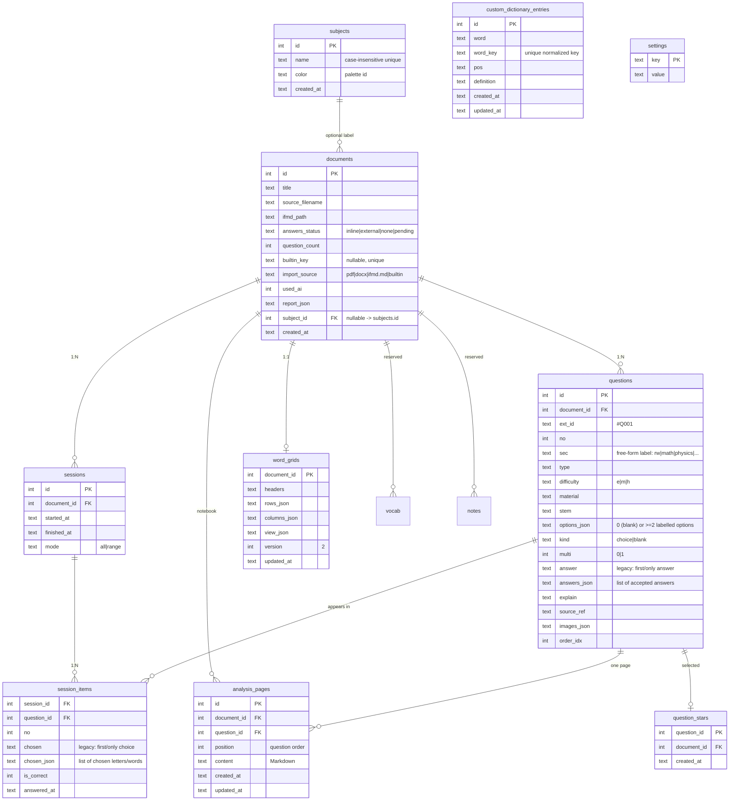

# InteFlow — Architecture

> 本地优先（local-first）的学习工作流应用。单机运行：FastAPI 后端 + React 前端 + SQLite 单文件；
> PDF 由 PyMuPDF 确定性转换；LLM 仅在用户显式操作时调用（导入主链路 0 token）。
>
> 基线：pytest **304 passed, 1 skipped**、`npm run build` 0 错误、`npm test` 138 passed, 5 skipped。
> 相关：[`README.md`](../README.md)、[`AGENT.md`](../AGENT.md)、[`IFMD.md`](IFMD.md)、[`IDEAS.md`](IDEAS.md)、[`ROADMAP.md`](../ROADMAP.md)。

---

## 1. 系统总览

```mermaid
flowchart LR
  subgraph Browser["浏览器 (React SPA · Vite + TS + Tailwind)"]
    UI["工作区侧栏: Exams / Library / Sessions / Review / Vocabulary / Settings<br/>考试流: AnswerKey / Practice / Result"]
    RT["RichText: react-markdown + remark-math + rehype-katex"]
  end

  UI -- "/api/* (Vite dev proxy :5173 -> :8000)" --> API

  subgraph Backend["FastAPI (app.main)"]
    API["routers: documents / imports / builtin / sessions / settings / ai / analysis / dictionary / custom_dictionary / vocabulary / word_exam / subjects / review"]
    CONV["convert: pdf · twocolumn · docx · images · normalize · ocr · llm_fallback"]
    PARSE["ifmd.parser (deterministic state machine)"]
    REPOS["repos: documents · imports · sessions · analyses · words · settings · subjects · review"]
    DICT["dictionary: Eudic .eudb parser + SQLite indexes (standard / learner, 0 token)"]
    ASSIST["vocab_assist: MW sense selection (explicit, optional AI)"]
    EXAM["word_exam: build / local grading / optional AI grading (explicit)"]
    SUBJ["subjects: user-defined labels for exam papers (0 token)"]
    REVIEW["review: mistakes (latest wrong) + starred questions (0 token)"]
    SEC["sections.py (free-form section labels)"]
    LLM["llm.base -> providers.py (19 providers, 2 protocols)"]
    API --> CONV
    API --> PARSE
    API --> REPOS
    API --> DICT
    API --> ASSIST
    API --> EXAM
    API --> SUBJ
    API --> REVIEW
    ASSIST --> LLM
    EXAM --> LLM
    CONV --> PARSE
    API --> LLM
  end

  REPOS --> DB[("SQLite  data/app.db")]
  REPOS --> FS[("data/docs/<id>/doc.ifmd.md + assets/")]
  DICT --> MW[("data/dictionary/mw.db (derived index)")]
  DICT -. reads in-entry learner section -> LEARN["learner_definition column (same index)"]
  DICT -. parses .-> EUDB[("dictionary/*.eudb (user-installed, gitignored)")]
  CONV --> FS
  LLM -- httpx --> PROV[("LLM providers (only on explicit user action)")]
```

### 关键不变量（Iron rules）
- **LLM 不在导入主链路**：导入/判分默认是纯确定性转换，0 token；AI 仅在用户显式操作时调用（AI 讲解、连通性测试、设置开启 `vocab_exam_ai_grading` 后的单词考试提交）。
- **正确答案不出后端**：练习接口 `quiz_questions()` 剥掉 `answer` 字段；只有提交/复盘接口返回。
- **本地优先**：全部数据在 `data/`（SQLite 单文件 + 文档/图片），无云依赖。
- **单文件数据库 + 文件系统并存**：SQLite 存索引与结构化题，`doc.ifmd.md` 存原始 InteFlow-MD（source of truth），`assets/` 存图片。
- **不局限于 SAT**：题目的 `sec` 是自由标签（见 §3、`app/sections.py`）。
- **一套试卷 = 一套复盘笔记本**：分析正文存 `analysis_pages`（一题一页，按题序）；复盘页顶部 **Notebook** 全屏预览（标题 + 所有已写解析的题干/图表/解析），导出 PDF/DOCX/MD 只含已写解析的题，并在 `data/exports/` 留一份副本（响应头 `X-Export-Path`）。
- **词典纯本地**：`.eudb` 只在首次查词时解析成本地 SQLite 索引 `data/dictionary/mw.db`（0 token）；`dictionary/` 里的版权文件不入库。部分词条内部的 **Definition for English Learners** 栏目在构建时拆到 `learner_definition`，`vocab_learner_definitions` 开启时优先使用、没有则回退普通释义。用户自定义词典存在 `app.db`，开启时先查自定义再查韦氏。拖词入生词本时可显式调用一次 LLM 选释义（`vocab_ai_sense` 可关）；关闭/无 key/失败时回退第一条释义。

---

## 2. 运行形态与数据目录

```
repo/
├── backend/                 FastAPI 应用
│   ├── app/                 源码（见 §5）
│   ├── tests/               pytest（260）
│   └── requirements.txt     fastapi uvicorn pymupdf python-multipart httpx pytest openpyxl weasyprint python-docx cairosvg
├── frontend/                Vite + React 19 + TS + Tailwind 4
│   └── src/                 页面/组件/api client（见 §4）
├── scripts/dev.sh           一键起后端(:8000)+前端(:5173)
├── dictionary/              用户放置的 Eudic .eudb（版权文件，gitignore）
├── data/                    运行期数据（gitignore）
│   ├── app.db               SQLite
│   ├── docs/<id>/           doc.ifmd.md + assets/
│   ├── dictionary/mw.db     由 .eudb 生成的可重建索引（含 learner_definition 列）
│   ├── tmp/                 上传暂存（用完即删）
│   ├── jobs/                导入流水线暂存
│   └── exports/             导出产物目录
└── docs/                    ARCHITECTURE / IFMD / IDEAS / legacy
```

环境变量：`INTEFLOW_DATA`（数据根，默认 `./data`）、`INTEFLOW_API`（Vite 代理目标，默认 `http://localhost:8000`）、
`INTEFLOW_OCR_LANG`（Tesseract 语言，默认 `eng`）、`INTEFLOW_DEFAULT_SECTION`（无板块标题时的回退标签，默认 `rw`）、
`INTEFLOW_DICTIONARY`（标准 `.eudb` 文件或目录，默认 `./dictionary`）、`INTEFLOW_DICTIONARY_INDEX`（索引路径，默认 `data/dictionary/mw.db`）。

---

## 3. 数据模型（ER）



保留但**不再写入**的表（历史占位）：`analyses`（旧版多分析记录；Review 只读展示）、`vocab`、`notes`、`llm_logs`。分析正文现用 `analysis_pages`（旧 `questions.explain` 首次读取时映射迁移，不落库）。

---

## 4. 前端结构

```
App.tsx (BrowserRouter)
└── AppShell  —— 非考试页包在纸墨工作区（左侧栏 + 移动抽屉）；复盘与练习全屏无壳
    ├── "/"                     ExamHomePage      —— Exams：选卷开考（统计 + 学科筛选 + 编号行）
    ├── "/library"              ImportPage        —— Library：导入流水线 + 模板 + 内置题库卡 + 试卷列表 + 学科管理
    ├── "/sessions"             SessionsPage      —— Sessions：所有作答历史（按时间倒序、搜索、删除）
    ├── "/mistakes"             MistakesPage      —— Review：Mistakes / Starred 两集合（搜索/过滤/排序/分析）
    ├── "/vocabulary"           VocabularyPage    —— 单词集合：顶部 Word list / Word test 两 tab（左考试索引 + 右词表编辑器 + 查词；单词考试）
    ├── "/settings"             SettingsPage      —— LLM 服务商配置 + 用户名 + AI 兜底 / 生词本 / 自定义词典 / 单词考试评分开关
    ├── "/doc/:id/answers"      AnswerKeyPage     —— 答案网格（多选 + 填空多答案）+ 批量粘贴 + 预览 + 学科归类（含侧栏）
    ├── "/doc/:id/practice"     PracticePage      —— 全屏练习（计时，无侧栏、保持 slate/blue）
    ├── "/session/:sid/result"  ResultPage        —— 载入会话 → 全屏复盘工作台（无侧栏）
    └── "/manage"               → 重定向到 /library（兼容旧链接）

components/  AppSidebar（六个 tab：Exams/Library/Sessions/Review/Vocabulary/Settings；桌面可 Compact 为图标栏）· RichText (markdown+KaTeX+图片) ·
             workspace/（Workspace 四选二分屏 · WorkspacePane 每侧头部四个图标按钮切换工具 · QuestionNav 左上角折叠悬浮题目导航 (All/Wrong/Correct) ·
             AnalysisEditor Pages 式分析页 (Write/Preview + 自动保存 + 单换行保留) · AiTutorPane AI 讲解 pane ·
             VocabularyPane 生词本 pane（拖词 + 可选 AI 选义 + 手动添加） · ExportDrawer 顶栏导出抽屉 ·
             NotebookPreview 整套解析预览/导出 · VocabGrid v2 电子表格 · Splitter 分隔条 ·
             WordExamPanel 单词考试设置/作答 · WordExamResultView 结果 + 二维码/JSON 下载 ·
             usePersistentLayout · useMediaQuery · icons）·
             SubjectControls（学科徽章 / 筛选条 / 行内选择 + 现场创建 / 管理弹窗） ·
             ImportPipeline · IfmdTemplate · LibraryList · BuiltinBankCard · CustomDictionaryManager（Settings 导入/增删） · ui/（设计系统原语；Review 用 SlidingTabs 滑块切换）
lib/         sections.ts（板块标签，与后端 sections.py 对齐）· wordExamQr.ts（紧凑分享 JSON + 多段 QR 分块）
             subjects.ts（学科调色板 + Tailwind 色调映射 + 筛选类型）
api/client.ts —— 类型化 API client（所有 /api 路径由 Vite 代理）
```

复盘布局持久化在 `localStorage` 键 `inteflow.workspace.v3.<docId>`（左右工具 + 左右比例）；
题目 / 分析 / AI Tutor / 生词本四者同级，每侧可从另外三者切换；选择已在另一侧的工具时两侧交换。默认左题目、右分析。
可拖拽分隔条为 `role="separator"` 且支持方向键。

**主题层**：`.app-theme[data-theme=…]`（`index.css`）为每套主题声明一组语义变量（`--t-bg / --t-surface / --t-accent / --t-danger…`），
再由一条共享规则把它们映射到全部 Tailwind 颜色族（`slate/blue/primary/red/emerald/green/amber/warning/paper/ink/seal/…`），
因此现存页面无需逐个改 class 即同步主题；另加少量特征样式（显示字体 `font-display`、圆角、纸墨风的描边主按钮、导航标记、遮罩、背景光）。
主题选择存在 `localStorage`（`inteflow.theme`），入口在 Settings → Appearance（`components/ui/ThemePicker.tsx`），
状态由 `src/theme.ts` 的 `useTheme()` 提供，`main.tsx` 在首帧前 `initTheme()` 写到 `<html data-theme>`。
**全屏练习页渲染在 `.app-theme` 之外**，保持原 slate/blue（并显式 `color-scheme: light`）；复盘页跟随主题。
移动端左侧栏收成顶部条 + 抽屉（`AppSidebar`）。桌面端可切到 **Compact**：80px 图标栏、hover 原生 tooltip；
状态存 `localStorage` 键 `inteflow.sidebar.compact`，移动端始终显示完整抽屉。

---

## 5. 后端模块图

```
app/
├── main.py                 FastAPI 装配（lifespan=init_db；CORS；13 个 router）
├── db.py                   SQLite 连接/迁移(_migrate)/SCHEMA；路径常量（DOCS_DIR/UPLOAD_TMP/JOBS_DIR/EXPORTS_DIR，ifmd_path()）
├── imports.py              导入流水线服务：detect → convert → commit（确定性，0 token；PDF/DOCX/InteFlow-MD 单一代码路径）
├── sections.py             板块标签（KNOWN_LABELS / DEFAULT_SECTION / label()）
├── providers.py            Provider 目录（19 家）+ protocol(openai|anthropic) 解析
├── api/
│   ├── documents.py        导入（调用 imports 服务）/列表/详情/题目/历史/答案/解析/词汇/导出/删除/资源
│   ├── imports.py          暂存导入流水线（POST/GET/commit/cancel/delete/ai-fallback）
│   ├── builtin.py          内置题库发现与导入（offline, 0 token）
│   ├── sessions.py         开始/列表/获取/提交/regrade/删除
│   ├── settings.py         读写配置/Provider 目录/probe
│   ├── analysis.py         复盘笔记本 CRUD + 导出（md/docx/pdf）+ meta（用户名/历史）
│   ├── ai.py               AI 讲解（显式触发；唯一 LLM 入口）
│   ├── dictionary.py       本地韦氏词典 status / lookup（自定义优先 + learner 栏目，0 token）
│   ├── custom_dictionary.py 用户自定义词典 CRUD / 导入
│   ├── vocabulary.py       全部试卷的生词本概览（计数 + 预览）
│   ├── word_exam.py        单词考试：开始（随机抽题、答案留后端）/ 提交判分
│   ├── subjects.py         学科 CRUD（名称/颜色）+ 试卷归属；文档 PATCH 在 documents.py
│   └── review.py           错题集 / 精选题集 / 星标接口（0 token）
├── dictionary/
│   ├── eudb.py             Eudic .eudb 容器解析（header / zlib blocks / HTML→纯文本）
│   └── store.py            派生 SQLite 索引构建 + 状态 + 精确/前缀/包含查询
├── vocab_assist.py         拖词选义：词性/首义提取 + 标准/学习者候选 + 可选 LLM 选择 + 回退
├── word_exam.py            单词考试核心：抽题（词表 Meaning，缺失回退韦氏首义）+ 本地判分 + 可选 AI 严格判分与回退
├── ifmd/parser.py          InteFlow-MD -> Question[]（确定性状态机 + 结构校验）
├── ifmd/writer.py          ParsedDoc -> InteFlow-MD 文本（反序列化，round-trip 用）
├── convert/
│   ├── pdf.py              PDF -> InteFlow-MD（PyMuPDF：文本/分栏/分块/题号/选项/答案回填/图片；扫描页走 OCR）
│   ├── twocolumn.py        双栏版面 profile（原 bluebook；徽章 + 行带对齐）
│   ├── docx.py             DOCX -> InteFlow-MD（python-docx；zip 安全；复用 pdf 管线）
│   ├── ocr/                跨平台 OCR（扫描 PDF；零 Python 依赖）
│   │   ├── base.py         引擎选择（Vision 优先 → Tesseract）+ OcrLine 契约
│   │   ├── vision.py       macOS Vision（pyobjc，可选；未装则不可用）
│   │   └── tesseract.py    系统 `tesseract` 二进制子进程 + TSV 解析（跨平台，可选）
│   ├── images.py           图片抽取落盘
│   ├── normalize.py        文本清洗 + 行级分类 + 板块标题启发式（SAT 调参；回退 DEFAULT_SECTION）
│   ├── llm_fallback.py     确定性失败时的逐页 LLM 打标（verbatim 校验 + 重试 1 次）
│   └── model.py            Item / BuiltQuestion / PageReport 数据结构
├── repos/
│   ├── documents.py        文档/题目持久化 + write/read ifmd + 资源
│   ├── imports.py          import_jobs 持久化（状态机）
│   ├── sessions.py         会话与判分（submit / regrade / history / list / delete；多选 + 填空）
│   ├── analyses.py         复盘页持久化（list/get/save/delete；迁移旧 questions.explain）
│   ├── words.py            词汇表 grid v2（columns_json + rows_json + view_json；v1 读取自愈升级）
│   │                         + 结构化条目：summaries / add_entry / update_entry / delete_entry（按列名映射、按词去重）
│   ├── subjects.py         学科：list / create / update / delete / exists（名称大小写不敏感去重、调色板轮换）
│   ├── review.py           错题（最近一次）与精选题查询、分析聚合、星标增删
│   ├── custom_dictionary.py 自定义词典：CRUD / 查词 / CSV·TSV·JSON·TXT 导入
│   └── settings.py         settings 键值（user_name / llm_fallback / 生词本/自定义词典/单词考试开关）
├── export/                  PDF/DOCX 导出（0 token）
│   ├── model.py            ExportDoc/ExportQuestion（聚合题目 + 词汇表；section_label 来自 sections.py）
│   ├── notebook.py         复盘笔记本渲染：Markdown / PDF / DOCX（含封面页）
│   ├── pdf.py              WeasyPrint：HTML/CSS -> PDF（页脚页码、内联图片/SVG）
│   ├── docx.py             python-docx：标题/段落/表格/内联公式 PNG
│   ├── math_render.py      TeX->SVG 桥（Node/MathJax，可选；缺失降级纯文本；进程内缓存）
│   └── mathjax/            Node 桥接（package.json + render.mjs；node_modules 不入库）
├── llm/base.py             统一 LLM 调用（temperature 0、60s 超时、有类型错误）
└── builtin/                内置题库（44 单元：manifest.json + <unit>/doc.ifmd.md + assets/）
```

---

## 6. 关键流程

### 6.1 导入（0 token 主链路）

两条入口共用同一服务 `app.imports`：
- `POST /api/documents`：一次性 detect → convert → commit。
- `POST /api/imports`：流水线（detect → convert → **review** → `POST /{id}/commit`），结果暂存 `jobs/<job_id>/`，附**逐页 `PageReport`**。

```
file ─► app.imports.validate_upload（大小/空/类型）
     ─► app.imports.convert_upload → ImportResult（ifmd + assets + warnings + pages）
        ├─ .md/.markdown/.ifmd.md ────► decode -> parse -> InteFlow-MD 文本
        ├─ .docx ──► convert.docx()（python-docx；zip 安全校验）
        │              └── 段落/表格/图片 -> Item 流 ─► 复用 pdf 的题号/选项/答案键管线 ─► InteFlow-MD
        └── .pdf ──► convert.pdf()
                       ├── 文本层可用 ──► 分栏/分块/题号/选项/答案回填/图片 ─► InteFlow-MD
                       │       └── 识别不到选项 ──► kind=blank（填空题，见 IFMD §3.1）
                       ├── 页文本密度低（扫描页）──► convert.ocr（Vision→Tesseract）
                       │       └── 无引擎 ──► 友好报错（装 Tesseract 或 macOS Vision）
                       └── 读不出 ─────► (兜底开关开 + 有 key) llm_fallback 逐页打标 ─► InteFlow-MD 校验
     ─► app.imports.commit() ─► create_document(import_source/used_ai/report_json)
        + set_ifmd_path + write_ifmd + write_assets + insert_questions  ──►  document
```

内置题库：`backend/app/builtin/<bank>/manifest.json + <unit>/doc.ifmd.md`，`/api/builtin` 发现，`add` 走同一条 ifmd 导入路径（离线、0 token、幂等：`documents.builtin_key`）。当前 1 个 bank、44 个单元。

### 6.2 练习与判分

```
POST /api/sessions             -> 建会话，返回 questions（answer 被剥离）
（前端全屏作答；选择题 multi=1 可多选；填空题输入文本；键盘 选项字母 / ←→）
GET  /api/sessions             -> 作答历史列表（仅 "已提交" 的作答，时间倒序，供 Sessions 页）
POST /api/sessions/{id}/submit -> 按当前答案键判分（多选全对；填空 NFKC 归一化），写 session_items，返回 items
POST /api/sessions/{id}/regrade-> 补录答案键后按已存 chosen 重判（未提交 409）
DELETE /api/sessions/{id}      -> 删除一次作答
```

> **一次提交 = 一条记录**：`POST /api/sessions` 只在开始练习时建一条**临时 session**（客户端提交要用的 id）；
> 只有 `submit` 才把 `finished_at` 写入，`GET /api/sessions` 与 `/{id}/history` 都只列 `finished_at IS NOT NULL`
> 的作答。中途离开练习页时前端会删掉这条临时 session，所以"点开考试"永远不会留下记录。

### 6.3 复盘 / AI / 导出

```
分析（手写，0 token）  GET/PUT/DELETE /api/documents/{id}/analysis/{qid}     -> 一题一页（analysis_pages）
解析（手写，0 token）  PUT  /api/documents/{id}/questions/{qid}/explain     -> 旧版单字段解析（保留；首次读分析时迁入）
笔记本清单             GET  /api/documents/{id}/analysis                    -> 全部页（按题序，懒创建）
封面元数据             GET  /api/documents/{id}/analysis-meta               -> 用户名 + 该卷历史作答
整套解析预览（0 token） 复盘页顶部 Notebook 按钮 -> 标题 + 已写解析题目的题干/图表/解析
笔记本导出（0 token）  GET  /api/documents/{id}/analysis/export/{md|docx|pdf}?only_analyzed=true
                       -> 只含已写解析的题；下载 + 存 data/exports/（X-Export-Path）
词汇表（0 token）      GET/PUT /api/documents/{id}/words                    -> v2 columns+rows+view（兼容 v1）
词汇条目（0 token）    POST/PATCH/DELETE /api/documents/{id}/words/entries… -> 按词去重；标准列按列名映射/按需创建
词汇导出（0 token）    GET  /api/documents/{id}/words/export                -> .xlsx（openpyxl；列序/列宽/冻结表头）
AI 讲解（显式）        POST /api/ai/answer {document_id, question_id}       -> 题干+材料+选项+学生作答；无 key 409
导出（0 token）        GET  /api/documents/{id}/export/{pdf|docx}          -> WeasyPrint + python-docx；数学走 MathJax SVG
```

界面：复盘页全屏（无侧栏）；题号导航默认缩到左上角，点击旋转展开为悬浮面板（All/Wrong/Correct），
点击某题即选中并收起；四选二分屏（题目 / 分析 / AI Tutor / 生词本，默认左题目右分析，选择另一侧已有的工具则交换）；
每侧头部把四个工具排成一行**图标 + 小字标签**按钮（Lucide 图标，当前项高亮 `aria-pressed`，另一侧的工具略淡并有“click to swap”提示），不再使用下拉菜单；
分析页 Write/Preview，900ms 防抖自动保存 + ⌘S，Preview 用 `remark-breaks` 保留单换行；
顶部 **Notebook** 打开整套解析预览，**Export** 打开导出抽屉（导出不再是分屏工具）。

### 6.4 本地词典、自定义词典与生词本

```
dictionary/*.eudb ─────────────► eudb（流式 zlib 块 + HTML 片段解析）
                  ─► split_learner_definition()（词条内 Definition for English Learners 栏目）
                  ─► dictionary.store.ensure_index() ─► data/dictionary/mw.db
                     entries(definition, learner_definition) + meta(version, learner_count)
                     （首次查词自动构建；INDEX_VERSION / 源文件变更则重建）
app.db custom_dictionary_entries ◄─ Settings 手动增删 / CSV·TSV·JSON·TXT 导入
GET  /api/dictionary/status                  -> 词典状态 + learner_count/learner_enabled + custom 计数
GET  /api/dictionary/lookup?q=...&source=    -> auto（自定义优先，再韦氏）/ standard（只韦氏）
GET  /api/custom-dictionary                  -> 自定义词典状态 + 词条
POST /api/custom-dictionary/entries          -> 新增/覆盖一个自定义词条
DELETE /api/custom-dictionary/entries/{id}   -> 删除词条
POST /api/custom-dictionary/import           -> 导入 CSV/TSV/JSON/TXT
GET  /api/vocabulary                         -> 每套试卷的词表计数 + 前 4 个词预览
POST /api/documents/{id}/words/entries       -> 手动加词（按词去重；POS/Meaning/Notes 列按需创建）
POST /api/documents/{id}/words/entries/from-entry     -> 用户点选某条（source=standard|custom，0 token）
POST /api/documents/{id}/words/entries/from-selection -> 拖词：自定义+韦氏候选 + 可选 AI 选义
```

- **Definition for English Learners 不是另一本词典**：它是部分韦氏词条内部的一个栏目。构建索引时
  `split_learner_definition()` 把它拆到 `learner_definition`；`vocab_learner_definitions` 开启时优先使用，
  词条没有该栏目就回退 `definition`。不再扫描 `dictionary/learners/`，也没有独立 learner 索引。
- **用户自定义词典**是全局词表（`custom_dictionary_entries`，word_key 大小写/标点归一化唯一），存在
  `app.db`；`custom_dictionary_enabled` 开启时查词先自定义再韦氏。Settings 的 **Manage my dictionary**
  支持导入与逐条增删。
- 拖词流程：题目/选项里的文本选择用原生拖拽（`application/x-inteflow-word`）落到生词本 pane；
  后端取该题 material + stem + options 作为上下文，向 LLM 只提供真实候选条目 id（自定义候选 id 形如
  `custom:12`，校验，不能编造），返回 `{entry_id, pos, definition, source}`；`vocab_ai_sense` 关闭时
  直接取第一条候选，不调用 LLM；无 key / LLM 失败 / 无法解析时回退第一条并附 `warning`。
  词典里完全没有该词时仍会把词加入词表（无释义），不会让拖拽死路。

### 6.5 单词考试（0 token；AI 评分为显式可选）

```
Vocabulary → Word test tab
POST /api/documents/{id}/word-exam          {mode, count|null}
   -> 从词表非空条目随机抽题（count=null 或 >= 可考词数 = 全测）
   -> zh-en: 题面 = Meaning（为空时回退韦氏首义）；en-zh: 题面 = Word
   -> 正确答案留在后端，questions 只含 row_id / position / prompt / pos
POST /api/documents/{id}/word-exam/grade    {mode, items:[{row_id, response}]}
   -> 本地判分：
      zh-en 拼写：忽略大小写/空格/标点；Word 列可用 ; / | 换行 逗号 列多个可接受拼写
      en-zh 释义：NFKC 归一化后 精确 / 分段 / 足够长子串（>=40%）/ 多词 token 包含
   -> 若 Settings 的 vocab_exam_ai_grading 开启且已配置模型：每 20 题一批交给 LLM，
      参考「词表释义 + 韦氏词典」，提示词要求严格，不接受含糊/宽泛答案；
      失败/无 key/无法解析时回退本地判分并在 warning 说明
   -> 返回每题 word / prompt / expected / response / is_correct / method / reason
      + total / correct / accuracy / ai_requested / ai_available / ai_grading
```

结果页（`WordExamResultView`）显示正确率与考察范围、逐题正确答案/用户答案，
并把分享数据编码为**紧凑 JSON 二维码**：`lib/wordExamQr.ts` 生成 payload（含 accuracy、
tested positions、每题 expected/response），按 900 字节分块、每块前缀
`IFWT1|<exam-id>|part/total|`；题量大时渲染多个 QR，同时提供 `.json` 下载。
`MAX_QUESTIONS = 500`，`WordExamPanel` 只有在首次点击 **Word test** tab 时才挂载
（避免 Vocabulary 页为未打开的面板请求设置）。

### 6.6 学科分类（Subjects，0 token）

```
GET    /api/subjects                 -> 学科列表（含 document_count）
POST   /api/subjects                 -> {name, color?}；名称去空白、最长 40、大小写不敏感唯一
PATCH  /api/subjects/{id}            -> {name?, color?}；改名会同步到所有使用该学科的试卷
DELETE /api/subjects/{id}            -> 删除学科；FK ON DELETE SET NULL 把试卷移回 Uncategorized
PATCH  /api/documents/{id}           -> {subject_id: number|null}；null = 移出学科
```

- 学科是**全局标签**（一张 `subjects` 表），每套试卷最多一个 `documents.subject_id`；不是逐题标签。
  逐题的 `sec` 仍是自由板块标签（rw/math/…），两者互不替代。
- 颜色存调色板 id（`blue/emerald/amber/rose/violet/cyan/lime/slate`），前后端共享同一套；
  创建时未指定颜色则按已有数量轮换。
- 前端入口：Library 每行内联下拉（含 `+ New subject…`，创建后自动归类）、Import 卡片可预选本次导入的学科、
  Answer-key 页顶部可改；Library 的 **Manage subjects** 弹窗支持增删改，并可按学科/Uncategorized 过滤；
  Exams 首页显示学科徽章与筛选 chips。
- 删除学科只影响归类，不删试卷、题目、答案、分析或词表。

### 6.7 错题集与精选题集（Review，0 token）

```
GET    /api/review/mistakes                 -> 所有已提交作答的错题
GET    /api/review/starred                  -> 所有精选题（含最近一次作答、分析）
GET    /api/review/starred/ids?document_id= -> 某套试卷的已星标 question_id（练习页恢复星标）
POST   /api/review/starred/{question_id}    -> 加星（幂等）
DELETE /api/review/starred/{question_id}    -> 取消星标
```

- **Mistakes**：SQL `ROW_NUMBER() PARTITION BY question_id ORDER BY session id DESC` 先取每题最近一次
  `session_items`，再只保留 `is_correct = 0`。因此同一题重复错只显示一次（用户答案取最近一次）；
  后来做对则自动移出；未评分（没有答案键）的最近作答不算错题。
- **Starred**：`question_stars(question_id PK, document_id, created_at)`，每题一行、级联删除。
  练习页 `☆ Star for review`、复盘工作台、Mistakes 列表都可即时加/取消星；`starred/ids` 让练习页恢复星标。
- 两类条目返回统一形状：题干/选项/图片/material、正确答案与用户答案、题型/多选、套题与学科、
  最近 attempt（session_id / finished_at）、星标状态、`analysis`（当前页）+ `analyses`（当前页 + legacy
  `analyses` 全部内容）。前端右侧复用 `AnalysisEditor` 编辑当前分析，额外旧分析只读列出。
- Review 页支持按套题/题干/选项/答案搜索、按 exam 过滤、Newest/Oldest 时间排序；Mistakes 与 Starred
  两个 tab 各自懒加载。

---

## 7. 当前 API 面（65 条）

| 方法 | 路径 | 作用 |
|---|---|---|
| POST | `/api/documents` | 导入（PDF / DOCX / md / ifmd.md，一次性） |
| POST | `/api/imports` | 暂存导入流水线（返回逐页报告） |
| GET | `/api/imports/{id}` | 查询导入任务状态/逐页状态 |
| POST | `/api/imports/{id}/commit` | 提交暂存结果落库 |
| POST | `/api/imports/{id}/cancel` | 取消任务 |
| POST | `/api/imports/{id}/ai-fallback` | AI 兜底（仅失败页） |
| DELETE | `/api/imports/{id}` | 删除任务 |
| GET/POST | `/api/documents` | 列表 |
| GET/DELETE | `/api/documents/{id}` | 详情 / 删除（级联） |
| PATCH | `/api/documents/{id}` | 修改元数据（目前为 `subject_id` 归类；`null` = Uncategorized） |
| GET | `/api/documents/{id}/questions` | 题目（含答案，后端用） |
| GET | `/api/documents/{id}/history` | 练习历史 |
| PUT | `/api/documents/{id}/answers` | 补录答案（多选/填空校验，同步 InteFlow-MD） |
| PUT | `/api/documents/{id}/questions/{qid}/explain` | 手写解析（旧版单字段） |
| GET | `/api/documents/{id}/analysis` | 复盘笔记本全部页 |
| GET | `/api/documents/{id}/analysis/{qid}` | 某题分析页 |
| PUT | `/api/documents/{id}/analysis/{qid}` | 保存某题分析 |
| DELETE | `/api/documents/{id}/analysis/{qid}` | 删除某题分析 |
| GET/PUT | `/api/documents/{id}/analysis-meta` | 封面元数据（用户名 + 历史） |
| GET | `/api/documents/{id}/analysis/export/{fmt}` | 导出笔记本 md/docx/pdf（`only_analyzed=true` 只含已写解析的题；存 `data/exports/`） |
| GET/PUT | `/api/documents/{id}/words` | 词汇表读写 |
| POST | `/api/documents/{id}/words/entries` | 加一个结构化词条（按词去重；标准列按名映射） |
| PATCH | `/api/documents/{id}/words/entries/{row_id}` | 修改一个词条 |
| DELETE | `/api/documents/{id}/words/entries/{row_id}` | 删除一个词条 |
| POST | `/api/documents/{id}/words/entries/from-entry` | 按词典条目 id + source 加词（0 token） |
| POST | `/api/documents/{id}/words/entries/from-selection` | 拖词入表：可选 AI 选最贴合上下文的韦氏释义 |
| GET | `/api/documents/{id}/words/export` | 词汇表 .xlsx |
| POST | `/api/documents/{id}/word-exam` | 从词表随机出卷（`count=null` 全测；答案留后端） |
| POST | `/api/documents/{id}/word-exam/grade` | 提交判分（本地；设置开启时 AI 严格判分，失败回退） |
| GET | `/api/vocabulary` | 全部试卷的生词本概览（计数 + 预览） |
| GET/POST | `/api/subjects` | 学科列表（含试卷数）/ 新建学科 |
| PATCH/DELETE | `/api/subjects/{id}` | 改名/换色 / 删除（试卷移回 Uncategorized） |
| GET | `/api/dictionary/status` | 韦氏索引状态 + `learner_count/learner_enabled` + 自定义词典计数 |
| GET | `/api/dictionary/lookup` | 本地查词（`source=auto|standard`；自定义优先，再韦氏；返回 learner_definition） |
| GET | `/api/custom-dictionary` | 用户自定义词典状态 + 词条（可搜索） |
| POST | `/api/custom-dictionary/entries` | 新增/覆盖一个自定义词条 |
| DELETE | `/api/custom-dictionary/entries/{id}` | 删除一个自定义词条 |
| POST | `/api/custom-dictionary/import` | 导入 CSV / TSV / JSON / TXT |
| GET | `/api/documents/{id}/export/{fmt}` | 导出 PDF / DOCX（0 token；数学经 MathJax SVG） |
| GET | `/api/documents/{id}/assets/{name}` | 题目图片 |
| GET | `/api/builtin` | 列出题库 |
| POST | `/api/builtin/{bank}/units/{unit}` | 加单个单元 |
| POST | `/api/builtin/{bank}/add-all` | 一键加整库 |
| POST | `/api/sessions` | 开始练习 |
| GET | `/api/sessions` | 作答历史列表（仅已提交的作答） |
| GET | `/api/sessions/{id}` | 会话详情（不含答案） |
| POST | `/api/sessions/{id}/submit` | 提交判分 |
| POST | `/api/sessions/{id}/regrade` | 补键重判 |
| DELETE | `/api/sessions/{id}` | 删除一次作答 |
| GET | `/api/review/mistakes` | 错题集（每题最近一次作答；后来做对自动移出） |
| GET | `/api/review/starred` | 精选题集（含最近作答与分析） |
| GET | `/api/review/starred/ids` | 某套试卷的星标 question_id 列表 |
| POST/DELETE | `/api/review/starred/{question_id}` | 加星 / 取消星标（幂等） |
| GET/PUT | `/api/settings` | 读写配置（Key 掩码；含 `user_name` / `llm_fallback` / `vocab_ai_sense` / `vocab_learner_definitions` / `vocab_exam_ai_grading`） |
| GET | `/api/settings/providers` | Provider 目录 |
| POST | `/api/settings/test` | 连通性测试 |
| POST | `/api/ai/answer` | AI 讲解（显式） |
| GET | `/api/health` | 健康检查（含可用 OCR 引擎 `ocr`） |

---

## 8. 相关文档
- [`IFMD.md`](IFMD.md) — InteFlow-MD 格式规范 + 结构校验规则
- [`IDEAS.md`](IDEAS.md) — 修改想法记录
- [`../AGENT.md`](../AGENT.md) — 项目交接与工作说明
- [`../ROADMAP.md`](../ROADMAP.md) — 路线图与已知缺口
- [`legacy/`](legacy) — 前身项目历史文档（参考）
