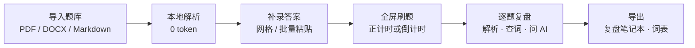
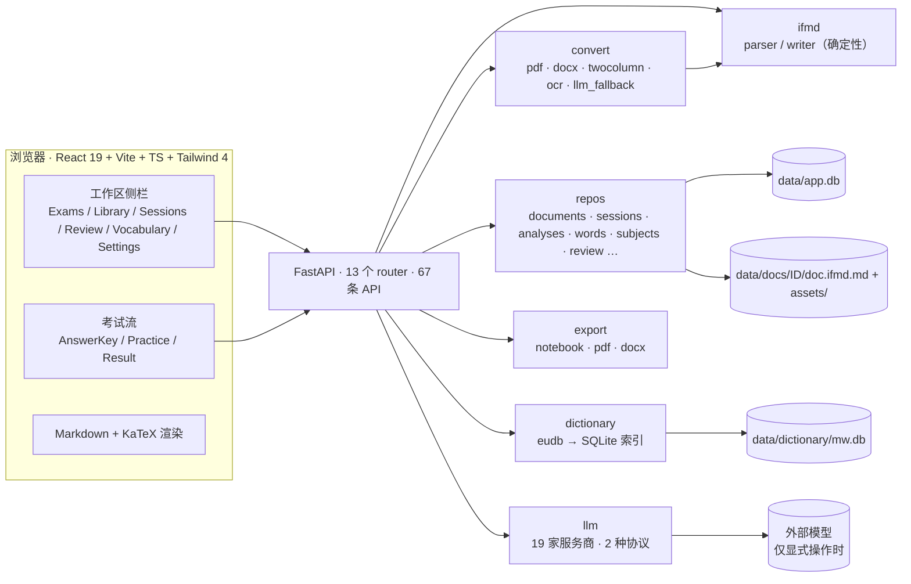

# InteFlow 作品说明

> **一句话**：InteFlow 是一个跑在自己电脑上的学习工作流应用——把 PDF / Word / Markdown 题库变成可刷的题，
> 刷完逐题复盘、写解析、收生词、按需问 AI，最后把复盘笔记和词表导出成文件。
>
> 本文面向第一次接触这个作品的读者，讲清楚**它是什么、为谁做、怎么用、做了什么取舍、完成到什么程度**。
> 工程细节见 [`ARCHITECTURE.md`](ARCHITECTURE.md)，题库格式见 [`IFMD.md`](IFMD.md)。
>
> 另提供 [`OVERVIEW.docx`](OVERVIEW.docx) 与 [`OVERVIEW.txt`](OVERVIEW.txt) 两个版本。

---

## 1. 为什么做这个作品

备考时真正耗时间的往往不是"做题"，而是做题之后的一整套动作：

- 题库散落在 PDF、Word、网课截图里，题目和答案要手工抄；
- 错题靠截图和收藏夹，几套卷子之后再也翻不出来；
- 想写解析、查生词、问 AI，得在四五个工具之间来回切换；
- 最后想复习，却没有一份能打印、能带走的错题分析。

现有的刷题产品大多要求你把题库上传到云端、绑定账号，解析和批改也常被包进模型调用里——既不可控，
也不便宜。InteFlow 的选择是：**把这条链路收进一个本地程序，用确定性代码完成能确定的部分，把 AI 留给真正需要它的瞬间。**

## 2. 作品定位

InteFlow 是一个**本地优先（local-first）的学习工作流 Web 应用**：

| 维度 | 选择 |
|---|---|
| 运行方式 | 单机运行：FastAPI 后端 + React 前端 + 一个 SQLite 文件，无云依赖 |
| 数据归属 | 全部数据在项目内的 `data/` 目录，题库原文、图片、作答、分析、词表都不出本机 |
| 成本模型 | 导入 / 解析 / 判分 / 导出默认 **0 token**；只有用户显式点击才调用外部模型 |
| 适用范围 | 不限于 SAT：题目的板块是自由标签（`rw`、`math`、`physics`、`history`……） |
| 使用门槛 | 一条命令启动，自带示例题库，装好即可用 |

它由作者此前的 SAT 刷题工具 **SATeacher** 全量迁移、改名并逐步泛化而来；前身的历史规划文档保留在
[`legacy/`](legacy) 仅作参考，当前规格以 `docs/` 与 `README*` 为准。

## 3. 两条铁律

这两条不是宣传语，而是写进代码结构的约束：

1. **LLM 不在主链路。** 导入、解析、判分、导出全部是确定性本地计算，0 token。外部 API 只在三种情况下被调用：
   用户点 **AI 讲解**、点 **连通性测试**，或在设置里主动开启"单词考试 AI 评分"后提交单词考试。
2. **本地优先。** 数据库、题库原文、图片、导出产物都在 `data/`；没有账号、没有云同步、没有后台上传。

由此派生出的第三条工程约定：**正确答案不出后端**——练习接口会把答案字段剥掉，只有提交和复盘接口才返回。

## 4. 五步工作流



1. **导入**：拖入文件，转换成统一的 InteFlow-MD，再解析成结构化题目入库；缺答案的卷子进入答案录入页。
2. **刷题**：考试式全屏界面，支持计时、题号面板、标记、键盘作答、多选与填空。
3. **复盘**：全屏工作台里左右分屏，一边看题，一边写自己的分析，随时查词或让 AI 讲解。
4. **沉淀**：错题自动汇总成 Mistakes，手动标记的题进入 Starred；每套卷子有一份生词表。
5. **导出**：把写过的解析导出成 Markdown / DOCX / PDF，把词表导出成 `.xlsx`，文件留在本机。

## 5. 功能全景

| 模块 | 能力 |
|---|---|
| **导入** | PDF（PyMuPDF 确定性转换：分栏、题号、选项、答案表回填、图片抽取）、DOCX（段落 / 表格 / 图片 + zip 安全校验）、`.md` / `.ifmd.md`；扫描页走 OCR（macOS Vision 或系统 `tesseract`，可选）；逐页导入报告、可暂停确认、可取消；单文件上限 60 MB |
| **格式** | InteFlow-MD（`.ifmd.md`）：`:::q` 题目块、`@material` / `@material2`（双篇）/ `@stem`、`! answer:` 元数据；确定性状态机解析，结构错误带行号报错，**不猜测**；材料里的单换行按原文保留（诗歌/摘录） |
| **内置题库** | 《SAT机考25年语文合集（下）》44 个单元 / 1186 题，离线、0 token、幂等，可单单元添加或一键全加 |
| **答案录入** | 逐题字母网格；多选（`multi=1`，答案 `A,C`）；填空（`kind=blank`，多个可接受答案用 `\|` 分隔）；批量粘贴（`1-A 2-C`、`1. A`、`ACBDA`、`3-AC`）；保存后回写题库源文件 |
| **练习** | 全屏、无侧栏干扰；**正计时 / 倒计时**可选，倒计时到 `00:00` 自动交卷，并按试卷记住上次的选择；题号面板、标记待看、键盘 `A`–`D` 与 `←` `→` |
| **复盘工作台** | 全屏、**2-of-5** 分屏（题目 / 分析 / AI Tutor / 生词本 / **词典**），每侧可切换并支持左右互换；左上角折叠式题号导航（All / Wrong / Correct）；可拖拽分隔条 |
| **分析编辑器** | Pages 式一题一页，Markdown（公式、图片），Write / Preview，约 0.9 秒防抖自动保存、`⌘S` 立即保存；可在设置里配置**分析模板**，空白页自动带入 |
| **Notebook** | 顶部一键预览整套解析：试卷标题 → 所有已写解析的题目（题干、图表、解析），可直接导出 |
| **Review** | **Mistakes**：所有已提交作答中的错题，按题去重、保留最近一次，后来做对自动移出；**Starred**：练习 / 复盘 / 错题列表里点的星。两栏都支持搜索、按套题过滤、按时间排序，并复用同一分析编辑器 |
| **生词本** | 一套试卷一份词表（Word · POS · Meaning · Notes）；从题目或选项拖词入表；手动增删改；导出 `.xlsx` |
| **本地词典** | 用户自备的 Eudic `.eudb`（韦氏）在首次查词时构建本地 SQLite 索引，92,006 条，0 token；支持词条内的 *Definition for English Learners* 栏目并自动回退普通释义；复盘工作台有独立 **Dictionary** 工具，可输入即查或手动添加自定义释义 |
| **自定义词典** | Settings 里导入 CSV / TSV / JSON / TXT，或逐条增删；开启后查词**先自定义、再韦氏**，拖词候选与单词考试释义也会优先使用 |
| **单词考试** | 从当前词表随机抽题，可指定数量或全测；**英译中**（手写释义）与**中译英**（看释义拼写）两种模式；默认本地宽松判分 0 token；可选 AI 严格判分，失败自动回退；结果含正确率、考察范围、逐题对照，并生成紧凑 JSON 二维码（大卷自动分片，`IFWT1\|id\|part/total\|`） |
| **学科分类** | 用户自定义学科（名称 + 颜色），每套试卷最多一个；Library 行内下拉即可归类或现场新建，Answer-key 页顶部可改，Exams 首页有徽章与筛选；删学科只把试卷移回 Uncategorized |
| **Sessions** | 所有**已提交**作答按时间倒序，可搜索、可删除；只有提交才算一条记录，点开考试不会留下痕迹 |
| **导出** | 复盘笔记本 md / docx / pdf（只含已写解析的题，封面含用户名，同时在 `data/exports/` 留副本）；整套试卷 PDF / DOCX；词表 `.xlsx` |
| **设置** | 19 家 LLM 服务商目录（默认 OrcaRouter，OpenAI / Anthropic 两种协议）、Base URL、API Key（掩码）、模型、连通性测试；用户名；分析模板；AI 识别兜底；AI 选义；学习者释义；自定义词典；单词考试 AI 评分；词典自动查词；自动填入释义；**English / 中文** 界面切换 |
| **外观** | 5 套主题（Clear Blue / Paper & Ink / Minimal Light / Midnight Navy / Warm Editorial），Settings → Appearance 即时切换；桌面侧栏可收成 80px 图标栏；移动端为抽屉 |
| **官网** | `website/` 纯静态多页中英双语站点：首页前段是平台下载区，`download*.html` 有 macOS / Windows 安装包与源码说明，`features*.html` 是完整功能与工作流，`demo*.html` 是四个浏览器内演示页（做题 / 2-of-4 工作区 / 错题集 / 生词集），`themes*.html` 是主题预览；由 GitHub Pages 自动发布 |

## 6. 设计上值得说的几个决定

### 6.1 用一份中间格式切断"解析"与"模型"

所有来源先转成 **InteFlow-MD**，再由纯函数解析器生成题目。好处是：格式可读、可手写、可 diff、可回写；
转换器和解析器各自可测试；链路里没有任何模型调用。转换器识别不到选项时按**填空题**处理，而不是猜；
选择题选项必须从 A 连续排列，否则带行号报错。宁可让用户修文件，也不产出似是而非的题。

### 6.2 一套试卷 = 一套复盘笔记本

分析不是零散笔记，而是 `analysis_pages` 里按题序排列的一页页文档。于是"复盘"和"导出"天然是同一份东西：
Notebook 预览看到什么，导出的就是什么；只包含真正写过的题，不会把整卷打印成空白模板。

### 6.3 复盘是分屏，不是弹窗

复盘页隐藏侧栏，把**题目 / 分析 / AI Tutor / 生词本**四者放在同一层级，每侧可以从另外三者中切换，
选择已在另一侧的工具时两侧互换。这样"看题—写解析—查词—问 AI"不需要跳页，也不会被固定布局限制。

### 6.4 把 AI 放在"可关、可退、可解释"的位置

- AI 讲解是显式按钮，不点不调用；
- 拖词选义只让模型**在真实词典候选里选**，不能编造释义；关掉开关就直接用第一条；
- 单词考试默认本地判分，AI 评分是设置项，失败或无 key 自动回退并在结果里说明；
- 导入的 AI 兜底也受开关控制，关闭时会明确提示如何启用。

### 6.5 本地词典，而不是在线查词

`.eudb` 是用户自备的版权文件（已 gitignore），首次查词时解析成可重建的 `mw.db` 索引。
英英释义、0 token、离线可用；换词典或索引版本变化会自动重建。

## 7. 技术架构



**技术栈**

| 层 | 选型 |
|---|---|
| 后端 | Python 3.11+、FastAPI、Uvicorn、PyMuPDF、python-docx、WeasyPrint、openpyxl |
| 前端 | React 19、Vite 7、TypeScript、Tailwind CSS 4、react-markdown + remark-math + rehype-katex |
| 存储 | SQLite 单文件 `data/app.db` + 每篇文档的 `doc.ifmd.md` 与 `assets/` |
| 可选 | 系统 `tesseract` 或 macOS Vision（OCR）、Node + MathJax（导出公式）、用户自备 `.eudb` 词典 |

**数据目录**（均在 `data/` 下，git 忽略）

```
data/
├── app.db                 SQLite：文档 / 题目 / 作答 / 分析 / 词表 / 学科 / 星标 / 设置
├── docs/<id>/             doc.ifmd.md（源文件）+ assets/（图片）
├── dictionary/mw.db       由 .eudb 生成的可重建词典索引
├── exports/               导出产物副本
├── jobs/                  导入流水线暂存
└── tmp/                   上传暂存
```

## 8. 完成度与规模

截至 2026-10-22 的记录：

| 指标 | 数值 |
|---|---|
| 后端测试 | `pytest` **309 passed, 1 skipped** |
| 前端组件测试 | `npm test` **149 passed, 5 skipped** |
| 前端类型检查 + 构建 | `npm run build` **0 错误** |
| API 面 | **67 条** |
| 内置题库 | **44 单元 / 1186 题** |
| 本地词典 | 韦氏 **92,006 条** |
| LLM 服务商目录 | **19 家**，2 种协议 |
| 界面主题 | **5 套** |
| 界面语言 | English / 中文 |

已完整落地的里程碑包括：从 SATeacher 全量迁移与改名、板块自由标签泛化、侧栏六区信息架构、
五套主题、复盘工作台重构、多选与填空题、作答历史、生词本与本地词典、单词考试、学科分类、
Review（错题 + 精选）、自定义词典、错题分析模板、正/倒计时、中英双语界面、项目官网与在线演示、
Electron 桌面安装包（macOS arm64/x64、Windows x64）与纯空安装 / 一键重置。

## 9. 怎么体验

```bash
git clone <your-repo-url> InteFlow
cd InteFlow
./start.sh          # macOS / Linux：缺环境会自动 setup，起 :8000 与 :5173 并打开浏览器
```

- **普通用户**：直接从[下载页](https://jasonsun2009cn.github.io/InteFlow/download.html)安装桌面版，
  不需要 Python / Node，也不会打开浏览器。
- macOS / Linux 在终端运行 **`./start.sh`**；Windows 用 **`start.ps1`** 或双击 **`start.bat`**（这是源码运行，会打开浏览器）。
- 只想建环境：`./scripts/setup.sh`；已有环境直接启动：`./scripts/dev.sh`。
- 打开 <http://localhost:5173>；后端健康检查 <http://localhost:8000/api/health>。
- 不想本地安装也可以先看静态官网 `website/index.html`，首页前段有平台下载；`website/demo.html` 可直接在浏览器里做题、交卷、复盘。

**最短上手路径**：Library → 导入题库（或先到 Settings 打开 **Show built-in library**，再展开内置题库卡片 →
**Add all**）→ 回 Exams → **Start** → 交卷 → 复盘写解析 →
Review 看错题 / Vocabulary 建词表 → Notebook 导出。

## 10. 适用人群与典型场景

- **备考学生**：把历年卷、模拟卷、老师发的 PDF 统一导入，刷题、归错、写解析、背生词，形成自己的复习资料。
- **教师 / 家教**：按学科归类试卷，用分析模板统一复盘结构，把笔记本导出成 PDF 发给学生。
- **多学科自学者**：不限于 SAT；任何"带题号 + 选项"的题库都能用，板块标签自己定。
- **注重隐私或离线环境的人**：模型可以完全不用；所有数据留在本机。

## 11. 边界与非目标

- **单用户、单机**：不做云同步、账号体系、多人协作。
- **不做 SRS 间隔复习**：词表与错题集是整理工具，不是记忆算法产品。
- **不替用户判断**：解析器遇到结构问题直接报错；AI 只做用户明确要求的讲解、选义或评分。
- **不把答案暴露给答题界面**：正确答案只在提交 / 复盘时返回。
- **AI 不是必需项**：没有 API key 时，除 AI 讲解与可选 AI 评分外的全部功能照常可用。

## 12. 文档地图

| 文档 | 内容 |
|---|---|
| [`../README.md`](../README.md) / [`../README-cn.md`](../README-cn.md) | 安装、使用、配置（英 / 中） |
| [`ARCHITECTURE.md`](ARCHITECTURE.md) | 系统架构、数据模型、关键流程、API 面 |
| [`IFMD.md`](IFMD.md) | InteFlow-MD 题库格式规范与校验规则 |
| [`IDEAS.md`](IDEAS.md) | 修改想法与已实现记录 |
| [`../AGENT.md`](../AGENT.md) | 项目交接与工作说明（给后续会话 / 贡献者） |
| [`../ROADMAP.md`](../ROADMAP.md) | 路线图与已知缺口 |
| [`legacy/`](legacy) | 前身项目历史文档（仅参考） |

## 13. 许可

[MIT](../LICENSE)。
